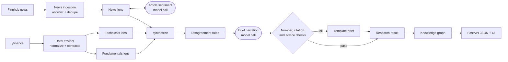

# QuantEra Research Lab

An equity research system where Python computes every number and a language model only narrates them. Every model output is checked against the data it was given; when a check fails, a deterministic template replaces it.

**[Explore the interactive architecture →](https://karan-patel11.github.io/quantera-ai/)**

The architecture page was drawn by reading the source code, not the old README. Each component is marked **implemented**, **partial** or **planned**, and links to the exact files it lives in.

## How a request flows

What runs today for `GET /api/research/{ticker}`:



Rounded boxes are the only places a model is called. Everything else is ordinary, unit-tested Python.

## Status at the audited commit

| | Count |
| --- | ---: |
| Implemented | 33 |
| Partial | 3 |
| Planned | 15 |

Known gaps, also shown on the page:

- Orchestration is one sequential function. LangGraph is planned and is not yet a dependency.
- 5 of 14 fundamentals metrics can never produce a value (EV/EBITDA, interest coverage, three growth metrics).
- The grounding check matches numeric values, not the claim a number is attached to.
- Statement data uses fiscal period dates, not filing dates, so it is not point-in-time.

The SEC 10-K validation harness reports 23 of 24 fields matching (95.8%) across 8 hand-verified companies; the one mismatch is a revenue-definition difference for XOM.

## What we're building

An equity research workbench where every figure traces back to a filing or a price series, every sentence a model writes is checked before it is shown, and missing evidence is reported instead of filled in. Three lenses run today; the target is eight, coordinated as a typed graph on point-in-time data. The roadmap, in order:

1. **Finish the lenses that exist.** Growth metrics from multi-year statements, EBITDA and interest expense in the data contract, tests on every pull request.
2. **Move orchestration to LangGraph.** Typed state, parallel lenses, grounding as a conditional edge, per-node telemetry.
3. **Make provenance point-in-time.** SEC company facts with filing dates; bind each generated number to the field it describes.
4. **Add five lenses.** Valuation (DCF, WACC), risk (VaR, expected shortfall), macro, institutional ownership (13F), portfolio.
5. **Deploy it publicly.** A hosted API and research UI.

## Where the code is

The application code (FastAPI service, research lenses, guards, validation harnesses and 90 unit tests) is kept on the [`archive/v0-code`](https://github.com/karan-patel11/quantera-ai/tree/archive/v0-code) branch, at the commit the architecture page audits ([`ea6e9ad`](https://github.com/karan-patel11/quantera-ai/tree/ea6e9ad1903ac9e35247f67df031e126343d3f70)).

```bash
git clone -b archive/v0-code https://github.com/karan-patel11/quantera-ai
cd quantera-ai
python3 -m pip install -e ".[dev]"
python3 -m pytest
```

## This repository

```
site/index.html            the landing page (Cytoscape.js, no build step)
site/architecture.json     component inventory: the single source of truth for the page
scripts/validate_manifest.py   checks the inventory before every deploy
.github/workflows/static.yml   validates, then publishes site/ to GitHub Pages
```

To change the map, edit `site/architecture.json` and push to `main`. To preview locally:

```bash
python3 -m http.server --directory site
```

## Disclaimer

Research and education only. QuantEra makes no buy, sell or hold recommendations and is not financial advice.

## License

See [LICENSE](LICENSE).
