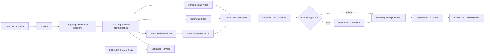
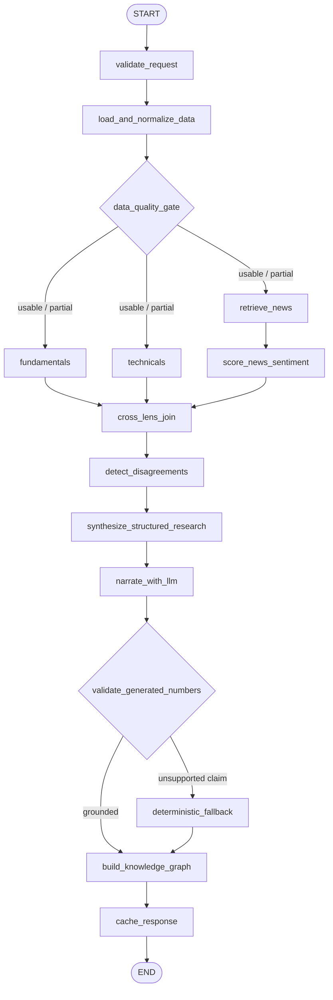
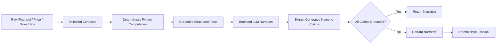

# 📊 QuantEra Research Lab

**A grounded AI research system for equity analysis — deterministic computation, LangGraph orchestration, provenance-first RAG, and fail-closed generation.**

*Enter a ticker → compute fundamentals and technicals → retrieve and score current news → detect cross-lens disagreement → generate a grounded research brief → inspect the result as an interactive knowledge graph.*

`research assistant — not a trading bot · no buy/sell calls · research, not financial advice`

> **Development status**
> Core data contracts, deterministic analysis, news/sentiment retrieval, synthesis, grounding checks, SEC validation, and the knowledge-graph output are implemented. The orchestration layer is currently being migrated to **LangGraph** so the workflow has explicit typed state, node-level execution, conditional routing, and auditable failure paths. The full dashboard and public deployment are also in active development.

---

## TL;DR

QuantEra is an **AI engineering project for grounded financial research**, not an LLM wrapper around market data.

The central rule is simple:

> **Code computes facts. The LLM explains facts. The graph controls what is allowed to happen next.**

For a ticker such as `AAPL`, QuantEra collects normalized financial, price, peer, and news data; runs independent analysis lenses; synthesizes them into a research brief; validates every generated numeric claim against a grounding registry; and renders the result as an interactive graph.

If a required value is missing, the system preserves that uncertainty as **`unavailable`**. If an LLM introduces an unsupported number, the generated explanation is rejected and the workflow routes to a deterministic fallback instead of returning an ungrounded answer.

This project is being built around four AI-engineering concerns:

1. **Reliable orchestration** — LangGraph-managed state and explicit workflow transitions.
2. **Grounded generation** — the model cannot invent financial values or silently fill missing data.
3. **Retrieval integrity** — news is filtered, cited, timestamped, and separated from deterministic market calculations.
4. **Evaluation before claims** — validation harnesses, reproducible tests, and fail-closed behavior are treated as product features.

---

## Why this exists

Many LLM-powered finance demos give the model too much authority: raw data goes into a prompt and a fluent answer comes out. That design makes it difficult to distinguish a calculated fact from a hallucinated number, stale source, or unsupported interpretation.

QuantEra uses the opposite architecture:

- deterministic Python computes financial and technical metrics;
- every structured value carries provenance and an as-of timestamp;
- retrieval code controls what external text reaches the model;
- LLM calls are restricted to bounded interpretation tasks;
- generated numbers are checked against known inputs;
- LangGraph coordinates execution and conditional fallback paths;
- missing or unverifiable information is preserved rather than guessed.

The result is a research workflow that is **inspectable, testable, and designed to fail safely**.

---

## What makes this an AI engineering project

| AI engineering concern | QuantEra design |
| --- | --- |
| Orchestration | LangGraph `StateGraph` coordinates deterministic and LLM-backed nodes |
| State management | Typed shared research state instead of passing loosely structured prompt blobs |
| Structured data | Pydantic contracts normalize upstream market data before downstream use |
| RAG / retrieval | News retrieval is source-filtered, timestamped, ranked, cited, and evaluated separately from calculations |
| Grounding | Every generated numeric claim must map back to a known structured value |
| Guardrails | Unsupported generated numbers cause a fail-closed route to deterministic output |
| Conditional routing | Validation results determine which LangGraph edge executes next |
| Reliability | Partial/missing upstream data remains explicit and does not become a fabricated zero |
| Evaluation | SEC 10-K ground truth, price sanity checks, unit tests, integration tests, and planned graph-transition tests |
| Observability | Node-level timing, routing decisions, validation outcomes, and model metadata are being added to the graph execution path |
| Cost / latency control | File TTL caching prevents unnecessary external API and model work |
| Model portability | Model-provider SDKs remain isolated so the orchestration layer is not coupled to one LLM vendor |

---

# System Design

## High-Level Architecture



The important architectural boundary is that **LangGraph orchestrates the workflow; it does not replace deterministic analysis**.

Financial ratios, technical indicators, aggregation logic, provenance checks, and validation rules remain normal tested Python functions.

---

# LangGraph Orchestration — In Development

The current codebase already has separate data, lens, synthesis, validation, and graph-building components.

The next system-design step is to move their composition into a **LangGraph `StateGraph`** rather than coordinating the full research request as a single application function.

LangGraph is being introduced because QuantEra is naturally a graph-shaped workflow:

- several analysis branches can run independently;
- later nodes depend on structured outputs from earlier nodes;
- generation must be gated by deterministic validation;
- failure should route to a safe path instead of collapsing the request;
- execution metadata should be inspectable per node;
- future checkpointing or human review can be added without rewriting the research modules.

## Target Workflow



---

## Proposed Research State

The graph uses a typed shared state rather than allowing nodes to exchange arbitrary prompt text.

```python
class ResearchState(TypedDict, total=False):
    ticker: str
    request_id: str

    financials: Financials
    price_history: PriceHistory
    news_items: list[NewsItem]

    fundamentals: FundamentalsResult
    technicals: TechnicalsResult
    news_sentiment: NewsSentimentResult

    disagreements: list[Disagreement]
    structured_synthesis: ResearchSynthesis

    narrative: str
    grounding_registry: dict[str, GroundedValue]
    grounding_status: str

    data_notes: list[str]
    errors: list[str]
    generated_at: str
```

The exact schema may evolve during implementation, but the invariant remains:

> **Nodes communicate through validated structured state, not hidden prompt assumptions.**

---

## LangGraph Node Responsibilities

| Node | Type | Responsibility |
| --- | --- | --- |
| `validate_request` | Deterministic | Normalize ticker input and reject malformed requests |
| `load_and_normalize_data` | Deterministic I/O | Fetch market data, map it into Pydantic contracts, attach provenance |
| `data_quality_gate` | Deterministic | Record missing fields and determine which parts of the workflow can execute |
| `fundamentals` | Deterministic + bounded narration | Compute valuation, profitability, financial-health, and growth metrics |
| `technicals` | Deterministic + bounded narration | Compute technical indicators from adjusted price history |
| `retrieve_news` | Retrieval | Apply source controls, ticker relevance, recency rules, and evidence capture |
| `score_news_sentiment` | LLM-assisted + deterministic aggregation | Classify articles and aggregate tone in code |
| `detect_disagreements` | Deterministic | Compare independent research lenses and surface conflicting signals |
| `synthesize_structured_research` | Deterministic | Build the machine-readable research object |
| `narrate_with_llm` | Bounded LLM | Convert approved structured facts into concise natural-language research |
| `validate_generated_numbers` | Deterministic guardrail | Reject numeric claims that cannot be traced to the grounding registry |
| `deterministic_fallback` | Deterministic | Produce safe output when generation fails |
| `build_knowledge_graph` | Deterministic | Build grounded Cytoscape.js nodes and edges |
| `cache_response` | Deterministic I/O | Persist versioned responses for repeat requests |

---

## Conditional Routing

The main value of LangGraph here is not “agents talking to each other.”

It is **explicit and testable control flow**.

```text
if upstream data is partial
    -> continue only with supported lenses
    -> attach data_notes

if LLM numeric grounding passes
    -> return generated narrative

if LLM numeric grounding fails
    -> discard generated narrative
    -> route to deterministic fallback

if one research lens is unavailable
    -> preserve the missing state
    -> synthesize only from available evidence
```

Control decisions remain in code rather than asking an LLM to decide whether its own output is trustworthy.

---

# Core Principle

## Code Computes. The LLM Narrates.



The LLM never needs to calculate:

- P/E ratios;
- RSI;
- moving averages;
- revenue growth;
- volatility;
- aggregate sentiment;
- provenance.

It receives already-computed structured values and is asked to **explain them**.

After generation, the system extracts numeric claims from the response and checks them against the values available to the node.

If a number cannot be traced:

> **The complete generated explanation is rejected.**

That is QuantEra's definition of **fail-closed generation**.

---

# Data Layer

Raw financial and price data is fetched and normalized into **fixed Pydantic contracts**.

## `Financials`

Each important line item carries metadata such as:

```text
value
is_present
source
as_of
```

## `PriceHistory`

Contains normalized daily:

```text
open
high
low
close
adjusted_close
volume
```

Downstream analysis consumes these validated contracts instead of raw provider payloads.

The provider is hidden behind a swappable data-source boundary, so the current free provider, `yfinance`, can be replaced without rewriting the research lenses.

A file-based TTL cache is currently the primary latency optimization because external retrieval dominates local computation time.

---

# Research Lenses

## 1. Fundamentals

Deterministic computation covers:

- valuation ratios;
- profitability metrics;
- financial-health metrics;
- growth metrics;
- sector-relative or absolute descriptive thresholds.

The LLM may explain already-computed results, but it does not calculate the underlying metrics.

---

## 2. Technicals

Technical analysis is calculated using **adjusted close** so corporate actions do not silently distort historical calculations.

Implemented indicators include:

- SMA(50)
- SMA(200)
- EMA(20)
- RSI(14) using Wilder-style smoothing
- 30-day annualized volatility
- trailing 1-month return
- trailing 3-month return
- trailing 1-year return
- volume analysis

Outputs are descriptive rather than prescriptive.

QuantEra does **not** generate buy/sell/timing recommendations.

---

## 3. News and Sentiment

News is the main retrieval-backed component of the system.

Current pipeline:

```text
Candidate News
      ↓
Source Whitelist
      ↓
Ticker Relevance
      ↓
Recency Filtering
      ↓
Evidence Preservation
      ↓
Per-Article Sentiment
      ↓
Deterministic Aggregation
```

Each article preserves:

- source;
- URL;
- publication timestamp;
- evidence;
- sentiment label.

The model cannot manufacture citations or determine the final aggregate sentiment independently.

---

# Why There Is No Vector Database Yet

The current news corpus is relatively small and highly time-sensitive.

QuantEra therefore begins with lightweight:

- relevance ranking;
- keyword matching;
- recency scoring;
- source quality controls.

A vector database will be introduced only if retrieval evaluation shows that the existing strategy materially misses relevant evidence.

This is deliberate:

> **Infrastructure should be introduced because evaluation demonstrates a need, not because an AI architecture diagram looks more impressive with it.**

---

# Cross-Lens Synthesis

The system compares independent analytical perspectives and surfaces disagreement explicitly.

Example:

```text
Fundamentals: weak

Technicals: neutral

News sentiment: positive

Result:
weak fundamentals vs. positive current news tone
```

The disagreement itself becomes structured research context rather than being hidden inside a generated paragraph.

---

# Grounded Knowledge Graph

The frontend renders results as an **Obsidian-style knowledge graph** using Cytoscape.js.

The company is the central node.

Connected clusters represent:

- fundamentals;
- technicals;
- news and sentiment;
- sector and peers;
- disagreements;
- research brief.

Individual metrics, articles, peers, verdicts, and evidence appear underneath those clusters.

> **The LLM does not create graph nodes or graph edges.**

The graph is generated from validated structured results, and relevant nodes and edges carry grounding metadata.

---

# Reliability and Guardrails

## Provenance-First Values

Important numeric values retain their origin and as-of timestamp.

## Missing Data Remains Missing

Missing values remain unavailable instead of silently becoming `0`.

## Numeric Grounding Validation

Generated numeric claims are compared against a registry of approved structured values.

## Fail-Closed Generation

Any unsupported generated number invalidates the LLM narrative.

The graph then routes execution to deterministic fallback output.

## Bounded Model Responsibility

Models handle:

- explanation;
- summarization;
- article-level classification.

Code handles:

- calculations;
- aggregation;
- routing;
- validation;
- provenance;
- graph construction.

## Provider Isolation

Groq is currently the default model provider, while Anthropic remains swappable.

Provider-specific SDK logic is isolated so the research architecture is not coupled to a single vendor.

## Versioned Caching

Versioned cache keys prevent older API response shapes from being served to newer frontend code.

---

# Evaluation and Validation

The original validation harness reported:

```text
100%
```

That result was invalid.

The supposed reference values had been fabricated by a coding agent rather than independently verified.

The harness was rebuilt to **fail closed whenever ground truth could not be verified**.

Human-verified values were then entered from SEC 10-K filings for eight sector-diverse large-cap companies.

## Current Validation Result

| Metric | Result |
| --- | ---: |
| Companies with human-verified SEC 10-K ground truth | 8 |
| Verified period-aligned fields | 24 |
| **Field-level match rate** | **95.8%** |
| Validation verdict | `PASS` |
| Documented discrepancy | XOM revenue-definition mismatch |

The important result is not just **95.8%**.

The stronger engineering outcome is that:

> **The system refuses to report successful validation using evidence it cannot independently verify.**

---

# Current Evaluation Surfaces

The project currently includes:

- unit tests against mock data sources;
- live `yfinance` integration smoke tests;
- SEC 10-K field-level validation;
- price-series sanity validation;
- split-continuity checks;
- news integrity checks;
- numeric grounding tests.

---

# LangGraph Evaluation — In Development

The graph architecture introduces additional tests for:

- state-schema validation;
- node input/output contracts;
- deterministic edge-routing;
- partial-data execution;
- guardrail pass/fail paths;
- fallback activation;
- graph-level latency;
- graph-level failure propagation;
- regression tests ensuring LLM output cannot bypass deterministic gates.

---

# Observability — In Development

The LangGraph execution path will capture node-level execution metadata.

Planned telemetry includes:

```text
request_id
node_name
start_time
end_time
latency
cache_hit
source_count
missing_data
model_provider
grounding_result
fallback_activation
graph_path
structured_errors
```

This should make it possible to answer questions such as:

- Which node made the request slow?
- Was cached or fresh data used?
- Why did the workflow enter fallback?
- Which source supported a generated claim?
- Which research lens failed?
- Did one branch fail while the rest completed successfully?

---

# Failure Model

QuantEra is designed for **degraded but explicit execution**.

| Failure | System behavior |
| --- | --- |
| Missing financial field | Mark unavailable rather than fabricating zero |
| Partial price history | Skip unsupported calculations and attach a data note |
| No trustworthy news | Return insufficient evidence for the news lens |
| LLM provider failure | Preserve deterministic analysis and use fallback where possible |
| Unsupported numeric claim | Reject generated narrative |
| Single lens failure | Preserve successful lenses and expose failure metadata |
| Stale cache schema | Versioned cache prevents reuse |

---

# API

Current endpoint:

```http
GET /api/research/{ticker}
```

Example:

```http
GET /api/research/AAPL
```

Core response fields:

| Field | Contents |
| --- | --- |
| `synthesis` | Fundamentals, technicals, sentiment, disagreements, narrative/fallback, sources, and data notes |
| `graph` | Ticker-centered grounded nodes and edges |
| `cached` | Whether the response was served from cache |
| `generated_at` | Freshness metadata |

The HTTP contract is intended to remain stable while the internal workflow is migrated to LangGraph.

---

# Current UI

```text
┌──────────────────────────────────────────────────────────────┐
│ AAPL · Apple Inc.              research, not financial advice│
├───────────────┬───────────────┬──────────────┬───────────────┤
│ FUNDAMENTALS  │ TECHNICALS    │ NEWS & TONE  │ PEERS/SECTOR  │
│ P/E   28.4 ▲  │ SMA50>SMA200  │ source + cite│ MSFT  GOOGL   │
│ Margin 25% ▲  │ RSI(14) 58    │ tone + evid. │ META   AMZN   │
│ D/E   1.4 ▼   │ Vol(30d) 22%  │ timestamps   │ Sector: Tech  │
├───────────────┴───────────────┴──────────────┴───────────────┤
│ RESEARCH BRIEF · disagreements · grounded numeric claims     │
└──────────────────────────────────────────────────────────────┘
```

Current local routes:

| URL | Output |
| --- | --- |
| `http://127.0.0.1:8000/` | Interactive knowledge graph |
| `http://127.0.0.1:8000/technicals` | Technical dashboard |
| `http://127.0.0.1:8000/api/research/AAPL` | Raw JSON research payload |

The full interactive dashboard is still under development.

---

# Tech Stack

| Layer | Technology |
| --- | --- |
| AI orchestration | **LangGraph** — integration in progress |
| Backend | Python 3.11+, FastAPI |
| Data contracts | Pydantic |
| Market data | yfinance |
| News | Finnhub |
| Ground truth | SEC 10-K filings |
| LLM | Groq default, Anthropic swappable |
| Retrieval | Source filtering + relevance/recency ranking |
| Knowledge graph | Cytoscape.js |
| Charts | Chart.js |
| Cache | File-based TTL cache |
| Testing | pytest + integration/validation harnesses |

---

# Deliberate Non-Choices

## No Graph Database

The UI contains a knowledge graph, but the graph is generated from one research request's validated payload.

A graph database would currently add operational complexity without solving a demonstrated persistence or query problem.

---

## No Vector Database Yet

Retrieval quality will be measured before adding a vector store.

If semantic retrieval provides measurable improvement, a vector database can be introduced behind the retrieval interface.

---

## No Microservices

The current workload does not require independently scaled services.

Keeping the architecture modular inside one FastAPI application reduces unnecessary operational complexity during development.

---

## No Autonomous Financial Agent

QuantEra does not give an LLM open-ended permission to:

- calculate metrics;
- choose arbitrary tools;
- modify financial facts;
- make investment decisions.

LangGraph provides **controlled orchestration**, not uncontrolled autonomy.

---

# Quickstart

## Prerequisites

```text
Python 3.11+
```

## Install

```bash
python3 -m pip install -e ".[dev]"
```

## Configure Environment Variables

Create a `.env` file:

```env
NEWS_API_KEY=your_finnhub_key
GROQ_API_KEY=your_groq_key
```

## Run

```bash
uvicorn quantera.server.app:app
```

---

# Current Direct Lens API

The existing research modules can still run independently while the LangGraph orchestration layer is being developed.

```python
from quantera import (
    DataProvider,
    FundamentalsLens,
    TechnicalsLens,
    NewsSentimentLens,
)

provider = DataProvider()

fundamentals = FundamentalsLens(provider).analyze("AAPL")
technicals = TechnicalsLens(provider).analyze("AAPL")
news = NewsSentimentLens().analyze("AAPL")

print(fundamentals.explanation)
print(technicals.explanation)
print(news.summary)
```

The README intentionally does **not** show a fictional LangGraph invocation API before the graph entry point is implemented and merged.

---

# Testing

```bash
# Unit tests
python3 -m pytest

# Live yfinance integration
python3 -m pytest -m integration

# SEC 10-K validation
python3 -c "from quantera.validation import run_validation; run_validation()"

# Price-series validation
python3 -c "from quantera.validation import run_price_validation; run_price_validation()"
```

Graph-transition and conditional-routing tests will be added as the LangGraph path is implemented.

---

# Project Status

| Component | Status |
| --- | --- |
| Data contracts and normalization | ✅ Complete |
| File TTL caching | ✅ Complete |
| SEC 10-K validation | ✅ Complete — **95.8% verified** |
| Fundamentals lens | ✅ Complete |
| Technicals lens | ✅ Complete |
| News retrieval and sentiment | ✅ Complete |
| Cross-lens synthesis | ✅ Complete |
| Numeric grounding guard | ✅ Complete |
| Deterministic fallback | ✅ Complete |
| Knowledge graph | ✅ Complete |
| **LangGraph orchestration** | 🚧 **In Development** |
| Typed graph state | 🚧 **In Development** |
| Conditional graph routing | 🚧 **In Development** |
| Node-level observability | 🚧 **In Development** |
| Full interactive dashboard | 🚧 **In Development** |
| Graph evaluation suite | ⬜ Next |
| Public deployment | ⬜ Next |

---

# Current Engineering Priorities

1. Wrap existing research stages as LangGraph nodes without rewriting deterministic business logic.
2. Define the shared `ResearchState`.
3. Implement fan-out/fan-in across independent research lenses.
4. Move grounding validation into an explicit conditional edge.
5. Preserve deterministic fallback for unsupported model output.
6. Instrument graph execution and routing.
7. Add graph-level regression tests.
8. Complete the dashboard.
9. Deploy once graph behavior and observability are stable.

---

# Engineering Thesis

> **The most useful AI system is not the one that gives the model the most autonomy. It is the one that makes the model's authority explicit, measurable, and constrained.**

In QuantEra:

```text
LangGraph
    ↓
orchestration and control flow

Pydantic
    ↓
data contracts

Python
    ↓
computation and validation

Retrieval
    ↓
evidence selection

LLM
    ↓
language and bounded interpretation
```

Each component has a narrow responsibility.

A fluent model response can never override a failed correctness check.

---

## ⚠️ Disclaimer

QuantEra Research Lab is a **research and educational tool**.

It makes **no buy/sell/hold recommendation** and is **not financial advice**.

Sentiment refers to sentiment within retrieved text and should not be interpreted as a prediction of future stock-price movement.

---

**Built by Karan Patel** · [GitHub](https://github.com/karan-patel11)

*research, not financial advice*
