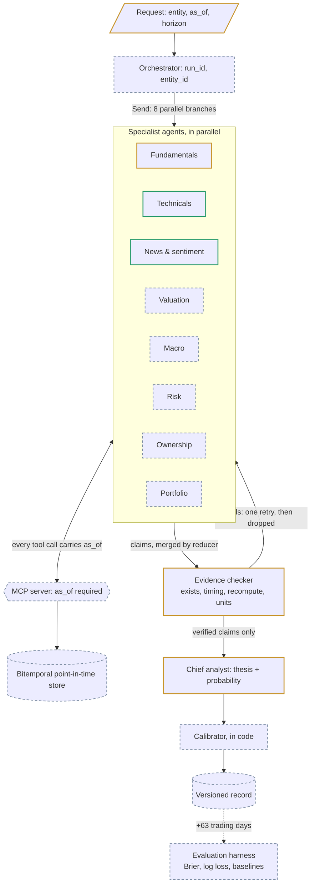

# QuantEra Research Lab

**A multi-agent equity research system, designed as a LangGraph state graph, where code computes every number and nothing ships until a checker verifies it.**

[**Explore the interactive architecture**](https://karan-patel11.github.io/QuantEra-AI/) · [v0 source code](https://github.com/karan-patel11/QuantEra-AI/tree/archive/v0-code)

> **Build status.** The deterministic core runs today: three research lenses, numeric and citation guards, and a template fallback, with 90 unit tests. The LangGraph agent graph described below is designed and is the next stage of the roadmap. The landing page marks every component as built, partial or designed.

---

## The problem

LLM research tools tend to fail in three ways:

1. **Temporal leakage.** They use information that was not public on the date being analyzed: restated financials, filings dated by fiscal period end instead of filing date, revised macro data.
2. **Untraceable numbers.** Models make arithmetic errors and invent figures. An analyst cannot defend a number that has no source.
3. **Unproven complexity.** Multi-agent systems are assumed to beat simpler methods without a controlled comparison.

QuantEra is designed around all three.

## Design principles

1. **LLMs reason; code calculates and verifies.** The model picks the method and the inputs. Deterministic Python produces every number.
2. **Point-in-time by construction.** Every fact carries the timestamp it became tradable, and the data interface enforces an as-of date on every query.
3. **Every claim is source-linked.** Each claim cites the fact rows and filing accession numbers it depends on.
4. **Independent verification.** A separate checker, not the authoring agent, validates citations, timing and math.
5. **Reproducible runs.** Every output records its data snapshot, prompt version, model ID and code commit.
6. **Prove it against baselines.** Probabilistic forecasts, proper scoring rules, walk-forward testing, and comparison with single-agent and no-LLM baselines.

## Architecture

The designed run. Solid boxes run today in some form; dashed boxes are designed.



Green outline: runs today. Amber: partly built. Dashed grey: designed.

### One request, end to end

1. **A request arrives** with an entity, an as-of date and a horizon.
2. **The orchestrator** creates a `run_id` and resolves the ticker to a permanent `entity_id`, so a ticker change such as FB to META stays one company.
3. **Eight agents start at once.** Each gets only the tools for its domain; the news agent cannot run a DCF.
4. **Every read goes through the as-of gate.** The MCP server returns only facts whose `tradable_date` is on or before `as_of`. No prompt can reach the future.
5. **The model reasons, code computes.** An agent chooses a calculation such as `yoy_growth` and its inputs; Python returns the value. The claim cites its fact IDs and accession numbers and must validate against a Pydantic schema.
6. **Fan-in at the evidence checker.** It confirms each cited fact exists, was tradable before `as_of`, recomputes the value within tolerance, and checks units and periods. It never sees the author's reasoning.
7. **One chance to fix a failed claim.** A failure goes back to its agent once with a reason code. A second failure is dropped and logged.
8. **The chief analyst decides** from verified claims only, weights agents by past calibration, and states disagreements instead of voting them away.
9. **Calibrate and record.** A calibrator fitted on past folds adjusts the probability in code, and the run is stored with everything needed to reproduce it.
10. **Score it later.** After the horizon, the evaluation harness scores the forecast against base-rate, calculation-only and single-agent baselines.

### Shared state

LangGraph nodes communicate through one typed state object rather than prompt text. Design sketch, not yet in code:

```python
class ResearchState(TypedDict):
    request: Request                                  # entity, as_of, horizon
    run_id: str
    entity_id: str
    claims: Annotated[list[Claim], operator.add]      # parallel agents append; none overwrite
    verdicts: dict[str, Verdict]                      # checker output per claim
    revisions: dict[str, int]                         # bounds the retry loop to one pass
    thesis: Thesis | None
    probability: float | None                         # calibrated
    record: RunRecord | None                          # snapshot, prompt version, model ID, commit
```

## What runs today (v0)

`GET /api/research/{ticker}` in the v0 code:


Rounded boxes are the only places a model is called. Everything else is ordinary, unit-tested Python.

- **Fundamentals, technicals and news lenses**, computed in code on validated Pydantic contracts. Missing values stay marked as unavailable and are never set to zero.
- **Guards on every model output.** Any number not present in the model's input, any link to a source that was not retrieved, or any buy/sell language rejects the draft.
- **Template fallback.** A rejected or failed draft is replaced by a brief built only from computed results.
- **Validation.** The SEC 10-K harness reports 23 of 24 fields matching (95.8%) across 8 hand-verified companies. The one mismatch is a revenue-definition difference for XOM.

### Known gaps

- Orchestration is one sequential function. LangGraph is designed but not yet a dependency.
- 5 of 14 fundamentals metrics can never produce a value (EV/EBITDA, interest coverage and three growth metrics).
- The grounding check matches numeric values, not the claim a number is attached to.
- Statement data uses fiscal period dates, not filing dates, so it is not point-in-time.

## Roadmap

1. **Finish the lenses that exist.** Compute growth from multi-year statements, add EBITDA and interest expense to the contract, and run tests on every pull request.
2. **Move orchestration to LangGraph.** Typed state, parallel agents, grounding as a conditional edge, per-node telemetry.
3. **Make provenance point-in-time.** Load SEC company facts with filing dates, and bind each generated number to the field it describes.
4. **Add five agents.** Valuation (DCF, WACC), risk (VaR, expected shortfall), macro, institutional ownership (13F), portfolio.
5. **Deploy publicly.** A hosted API and research UI.

## Repository

This branch holds the landing page. The v0 application (FastAPI service, lenses, guards, validation harnesses and tests) is on [`archive/v0-code`](https://github.com/karan-patel11/QuantEra-AI/tree/archive/v0-code), at the commit the architecture page audits ([`ea6e9ad`](https://github.com/karan-patel11/QuantEra-AI/tree/ea6e9ad1903ac9e35247f67df031e126343d3f70)).

```
site/index.html                 landing page (Cytoscape.js, no build step)
site/architecture.json          single source of truth: components, request flow, roadmap
scripts/validate_manifest.py    checks the manifest before every deploy
.github/workflows/static.yml    validates, then publishes site/ to GitHub Pages
```

Preview the page locally:

```bash
python3 -m http.server --directory site
```

Run the v0 code:

```bash
git clone -b archive/v0-code https://github.com/karan-patel11/QuantEra-AI.git
cd QuantEra-AI
python3 -m pip install -e ".[dev]"
python3 -m pytest
```

## Disclaimer

Research and education only. QuantEra makes no buy, sell or hold recommendations and is not financial advice. Example values in the design (entity IDs, dates, probabilities) are illustrative, not results.

## License

See [LICENSE](LICENSE).
